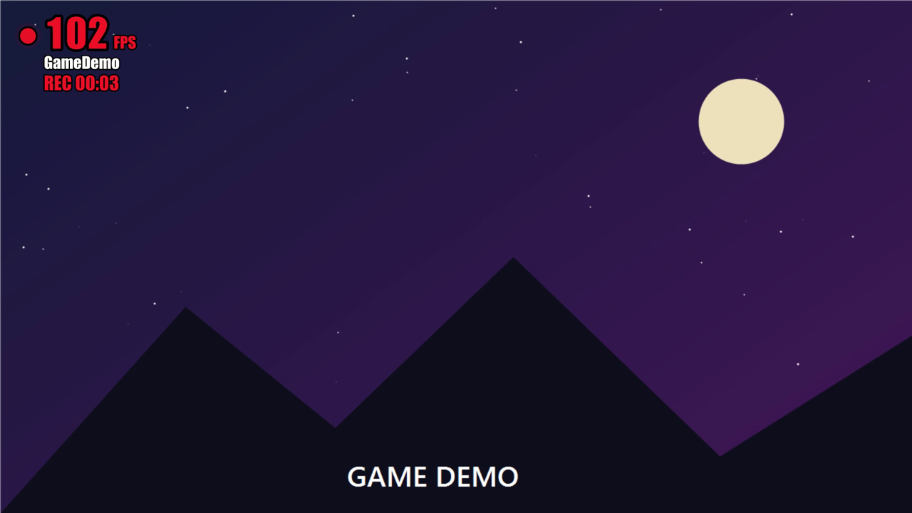
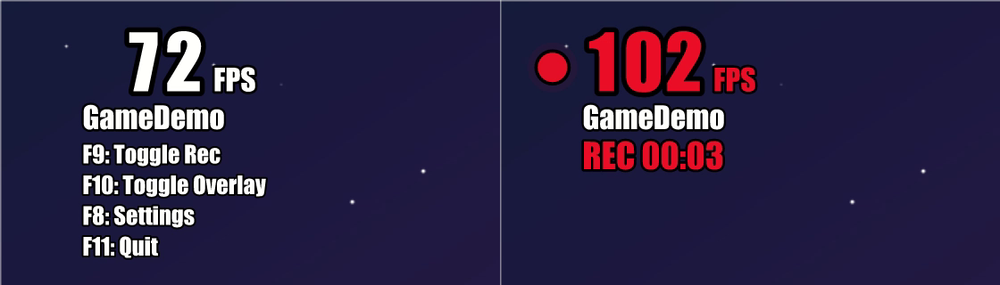
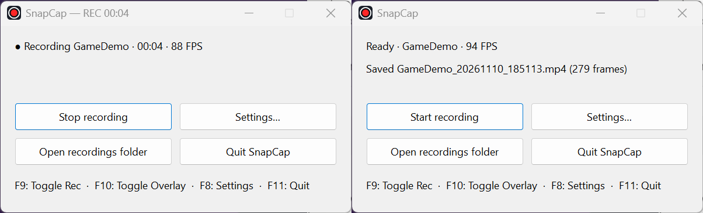
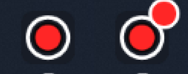
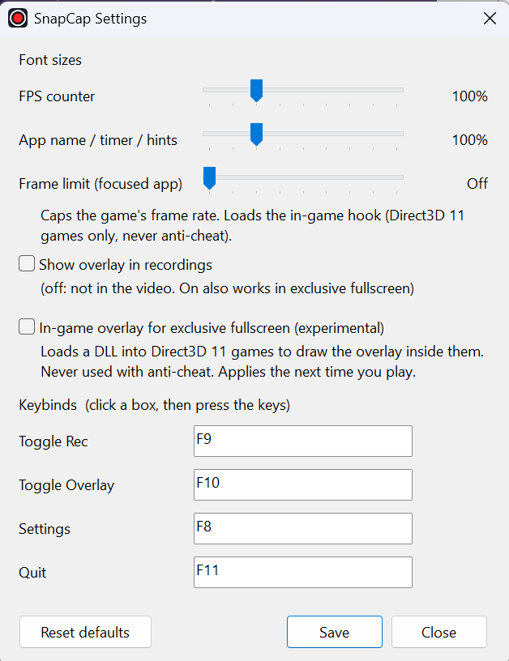

<h1 align="center">SnapCap</h1>

<p align="center">
  <b>A featherweight gameplay recorder for Windows, with a clear, bold FPS counter on top.</b><br>
  Records the window you're playing to MP4, captures <i>only that app's audio</i>, and shows live FPS,<br>
  the app name and a pulsing <b>REC</b> timer, even over exclusive fullscreen.
</p>

<p align="center">
  <a href="https://github.com/jinple/snapcap/releases/latest"></a>
  
  
</p>

<p align="center">
  
</p>

## Why SnapCap

- **Tiny and fast.** One ~1&nbsp;MB exe, no ffmpeg, no runtime to install. Hardware H.264 encoding; in testing it holds 60&nbsp;fps at 4K (RTX&nbsp;3080).
- **The FPS counter is the point.** Big, bold, white with a black outline when idle; red with a pulsing dot when recording, like a LIVE sign. The app name and a REC timer sit underneath.
- **Only the game's sound.** Audio comes from the app you're recording (and its child processes), not your music, chat or notifications.
- **Works over exclusive fullscreen.** Most overlays can't. SnapCap can burn its overlay into the video in software, and (opt-in, Direct3D&nbsp;11) draw it inside the game itself.
- **Frame limiter.** Cap the focused game's frame rate from the settings window.
- **A proper Windows app.** Its own icon, a taskbar button that shows when it's recording, no console window, and an installer.
- **Private.** No network access, no telemetry, no account. Nothing leaves your PC.

## Install

1. Download **`SnapCap-Setup-<version>.exe`** from the [latest release](https://github.com/jinple/snapcap/releases/latest).
2. Run it. No admin rights needed; it installs for your user, adds a Start Menu entry, and can optionally add a desktop shortcut and start with Windows.

> **"Windows protected your PC"?** The installer isn't code-signed yet, so SmartScreen may warn on first run.
> Click **More info → Run anyway**. Every release ships a `.sha256` file if you want to verify the download.

Requires **Windows 10 version 2004 (build 19041) or newer**. That's what per-app audio capture and hiding the overlay from recordings depend on.

## Quick start

1. Start SnapCap. A small window appears and the overlay shows in the corner of whatever you have focused.
2. Play your game. Press **F9** to start recording, **F9** again to stop.
3. Your video is in `Videos\SnapCap\<app>_<date>_<time>.mp4`. The **Open recordings folder** button takes you there.

| Key | Action |
| --- | --- |
| **F9** | Start / stop recording |
| **F10** | Show / hide the overlay |
| **F8** | Open settings |
| **F11** | Quit |

These are global hotkeys and every one can be rebound in settings.

<p align="center">
  <br>
  <sub>Idle (left) and recording (right).</sub>
</p>

### The control window and taskbar

SnapCap has a small window of its own: live status, the last saved file (or the error, if something went wrong), and buttons for Start/Stop, Settings, Open recordings folder and Quit. It's also your "is it still running?" indicator: the taskbar button's title shows `SnapCap — REC 00:42` and the icon gets a **red badge** while recording.

<p align="center">
  <br>
  
</p>

Closing the window (or the taskbar's *Close window*) quits SnapCap and finishes any recording cleanly first. Launching with `--minimized` (what the *start with Windows* option uses) tucks it into the taskbar instead.

## What gets recorded

- **The target** is the fullscreen window on top, otherwise the window with focus. The overlay's app name shows which. The target is locked when you press record, so alt-tabbing doesn't change what's being filmed.
- **Video** is H.264 at 60&nbsp;fps / 16&nbsp;Mbps by default (hardware-encoded when your GPU supports it).
- **Audio** is AAC stereo, from that app and its child processes only. If the app is silent, so is the track. Recording the desktop itself has no audio.
- **Not recorded:** the mouse cursor, your microphone, and sound from other apps.
- Recordings capture the *screen region* of the window, so for normal windowed apps anything covering it will be in the video. (In-game hook mode, below, captures the game's own frames instead.)

## Settings

Press **F8** (or click *Settings…*).

<p align="center">
  
</p>

| Setting | What it does |
| --- | --- |
| **Font sizes** | Scale the FPS number and the smaller text (app name, timer, hotkey legend) independently, 50–250%. Changes apply live. |
| **Frame limit** | Cap the focused game's frame rate, up to 240 FPS, or *Off*. See [Frame limiter](#frame-limiter). |
| **Show overlay in recordings** | Off by default: you see the overlay, the video doesn't. Turn it on to burn the overlay into the video. This works even in exclusive fullscreen. |
| **In-game overlay for exclusive fullscreen** | Experimental, off by default. See [Exclusive fullscreen](#exclusive-fullscreen-and-the-in-game-hook). |
| **Keybinds** | Click a box and press the combo you want. Letters and numbers need Ctrl/Alt/Shift; function keys can be used alone. SnapCap warns about duplicates and keys another app already owns. |

Settings live in `%APPDATA%\SnapCap\settings.ini` and are kept when you uninstall.

## What the FPS number means

For an ordinary window, SnapCap measures how often the screen updates. That tracks a game's frame rate, but it's an approximation: it counts changes to the display, not the game's own frames (a mostly static window can read oddly). For games running the in-game hook it's the game's **exact** rate: the number of frames it actually presents per second.

## Exclusive fullscreen and the in-game hook

In *exclusive* fullscreen, Windows hands the screen to the game and no other window can be drawn on top, so a normal overlay can't appear. Borderless / "windowed fullscreen" modes are unaffected. For exclusive fullscreen you have two options:

1. **Burn-in (always works).** Turn on *Show overlay in recordings*. SnapCap draws the overlay into the recorded frames itself.
2. **In-game overlay (experimental, Direct3D 11 only).** Tick *In-game overlay for exclusive fullscreen* to see the overlay live, drawn inside the game. With it, recordings come from the game's own clean frames, so the overlay is only in the video if you want it there.

<details>
<summary><b>What the in-game hook does, and when SnapCap refuses to use it</b></summary>

<br>

It's opt-in and used only when you've asked for it (the checkbox above with a game in exclusive fullscreen, or a frame limit). Then SnapCap loads `snapcap_hook.dll` into the game and hooks `IDXGISwapChain::Present`. Everything it draws goes through a deferred Direct3D context that's replayed with the game's state restored, and it goes idle automatically if SnapCap exits.

SnapCap **never** injects into:

- anything with anti-cheat (EasyAntiCheat, BattlEye, Vanguard, FACEIT, XIGNCODE, GameGuard and similar),
- 32-bit processes, or games that aren't Direct3D&nbsp;11 (Direct3D&nbsp;12, Vulkan and OpenGL games are skipped),
- the Windows shell and system processes, browsers, Chromium/Electron apps, OBS, IDEs and similar tools.

If it declines, the control window tells you why. Even so: **don't use the in-game hook or frame limiter with online games that use anti-cheat.** Code injection can break a game's terms of service whether or not it's detected.

The DLL stays loaded in the game until the game exits (it does nothing once SnapCap is closed). Rebuilding or updating `snapcap_hook.dll` while a hooked game is running won't work until you close the game.

</details>

## Frame limiter

Set a cap in settings and the **focused** game is paced to it (0 = off, up to 240). It works by holding each frame back until its slot is due, so frames go out evenly. Details worth knowing:

- It uses the in-game hook, so it applies to Direct3D&nbsp;11 games (and is refused for anything on the list above).
- It can't push a game *above* its own limits (VSync, an in-game cap). It only brings it down.
- The cap applies to whatever is focused; other hooked games run unlimited.
- If SnapCap exits or stops responding, the game is released automatically within a couple of seconds.

## Command line

```text
snapcap.exe [options]

  --fps N        capture rate (default 60, max 240)
  --bitrate N    video bitrate in Mbps (default 16)
  --out DIR      output folder (default %USERPROFILE%\Videos\SnapCap)
  --no-overlay   start with the overlay hidden
  --minimized    start minimized to the taskbar
  --help         show this list
```

SnapCap is a GUI app, but when started from a terminal it prints to that terminal.

## Troubleshooting

| Problem | What to try |
| --- | --- |
| **Overlay is missing over a game** | Check the game isn't in *exclusive* fullscreen. Switch it to borderless, or enable the in-game overlay (Direct3D 11) or *Show overlay in recordings*. |
| **"Recording failed while …"** | The control window names the step that failed. Please [open an issue](https://github.com/jinple/snapcap/issues) with that line and your GPU/Windows version. |
| **The recording has no audio** | Per-app audio needs Windows 10 2004+. Recording the desktop has no audio by design, and the app has to have been playing sound in that window's process. |
| **A hotkey doesn't work** | Another app may own that combo. SnapCap tells you when you save a binding it couldn't register. Pick another in settings. |
| **Antivirus flags it** | It's an unsigned app that (only when you opt in) injects a DLL, which heuristics dislike. The source is here, and you can build it yourself. |
| **FPS looks off on a plain window** | Without the hook it measures screen updates, not the app's own frame rate. See [What the FPS number means](#what-the-fps-number-means). |

## Build from source

You need Windows 10/11, a recent stable [Rust](https://rustup.rs) toolchain (edition 2024) and the MSVC build tools with the Windows SDK (it provides `rc.exe`, used to embed the icon).

```powershell
git clone https://github.com/jinple/snapcap
cd snapcap
cargo build --release     # builds snapcap.exe and snapcap_hook.dll into target\release
```

`snapcap_hook.dll` must stay next to `snapcap.exe`.

<details>
<summary><b>How it works / project layout</b></summary>

<br>

| Path | What it is |
| --- | --- |
| `src/main.rs` | App state, window messages, hotkeys, target selection (fullscreen-on-top, else focus), overlay window |
| `src/capture.rs` | DXGI desktop duplication → Media Foundation H.264/MP4; high-resolution pacing; staging ring so the CPU never stalls on the GPU; software overlay burn-in |
| `src/audio.rs` | WASAPI process-loopback capture of the target process tree, on a clock shared with video |
| `src/overlay.rs` | Overlay renderer (glyph outlines with `tiny-skia`, so the outline is properly anti-aliased) |
| `src/main_window.rs` | The control window, taskbar badge and status text |
| `src/settings.rs`, `src/settings_ui.rs` | Settings storage and the native settings window |
| `src/hook_client.rs` | SnapCap's side of the in-game hook: vetting, injection, shared memory |
| `hook/` | The injected DLL: `Present` hook, in-game overlay, clean-frame sharing, frame limiter |
| `installer/`, `scripts/` | Inno Setup installer, release script, icon generator |

The live overlay is a click-through layered window that's always excluded from screen capture; when you want it in the video, the recorder draws the same pixels into each frame instead. In hook mode the game copies each back buffer into a shared GPU texture *before* drawing the overlay, and the recorder reads that, which is how the overlay can be visible live yet absent from the recording.

</details>

## Releasing

Maintainers: add a section to [`CHANGELOG.md`](CHANGELOG.md), then

```powershell
scripts\release.ps1 -Version 0.2.0              # bump, build the installer, tag, push, publish
scripts\release.ps1 -Version 0.2.0 -NoPublish   # just build dist\SnapCap-Setup-0.2.0.exe
```

This needs [Inno Setup 6](https://jrsoftware.org/isinfo.php) and the [GitHub CLI](https://cli.github.com) (`gh`). The changelog section becomes the release description, and the installer plus its SHA-256 are attached. `scripts\make-icon.ps1` regenerates the app icon.
